# Keel

[](https://github.com/df2k2/keel/actions/workflows/ci.yml)
[](https://github.com/df2k2/keel/actions/workflows/codeql.yml)
[](https://github.com/df2k2/keel/releases/latest)
[](LICENSE)

A security-first WordPress block theme for local service businesses: fast and accessible by
construction, zero third-party requests, no JavaScript on pages that do not need it, and output
ready for a strict content security policy. Everything is core blocks and `theme.json`, so the
content stays portable and no page builder is involved. "Keel" is a working codename; the theme
ships with a rename script.

Requires WordPress 7.1 or later and PHP 8.3 or later. Licensed GPL-2.0-or-later.

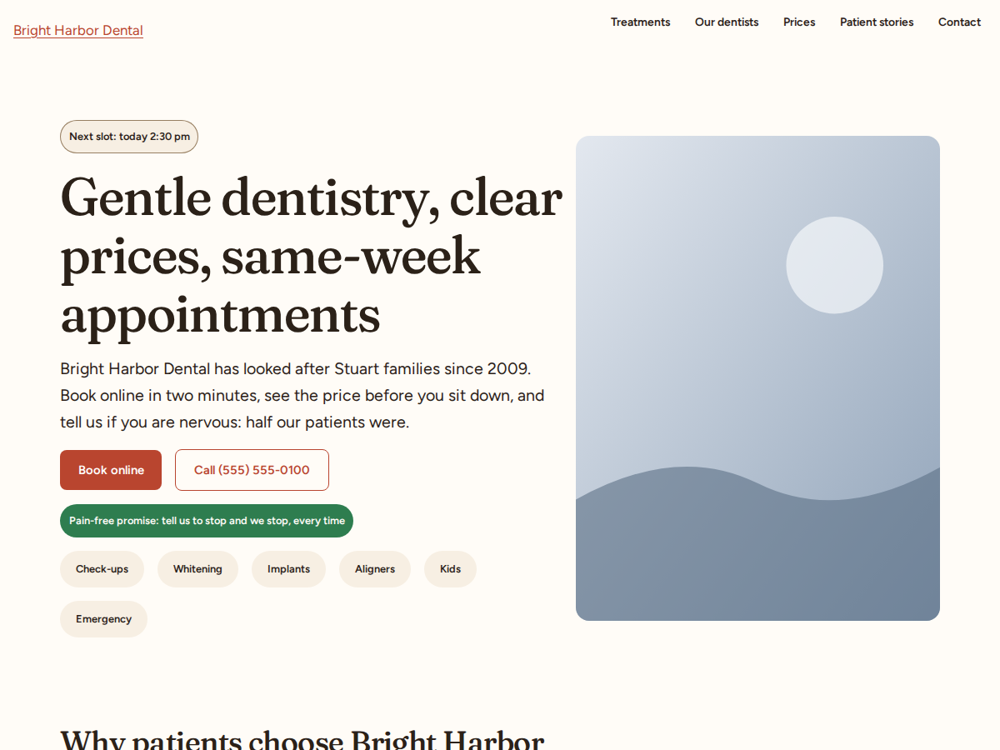

## Contents

- [Why Keel](#why-keel)
- [What ships](#what-ships)
- [Screenshots](#screenshots)
- [Requirements](#requirements)
- [Installation](#installation)
- [Getting started](#getting-started)
- [Customising](#customising)
- [Development](#development)
- [Quality gates](#quality-gates)
- [Releases](#releases)
- [Security](#security)
- [Translations](#translations)
- [Status](#status)
- [Documentation](#documentation)
- [License and credits](#license-and-credits)

## Why Keel

Most small business sites run a page builder plus a dozen plugins. That stack is slow, hard to
keep updated and the most often compromised. Keel takes the opposite position:

- **Core blocks only.** Every template, part and pattern is built from WordPress core blocks and
  styled through `theme.json`. Switch themes and the content still renders.
- **Curated patterns instead of a builder.** Heroes, services, pricing, FAQ, team, testimonials,
  contact, journal, listings, events and deals are all one click away in the inserter, and the
  new-page chooser offers whole page layouts.
- **Measured performance.** Lighthouse budgets run in CI on every pull request: 35 KB of CSS,
  15 KB of JavaScript, zero third-party requests, and no JavaScript at all on static pages.
- **Accessible by construction.** WCAG 2.2 AA is a build rule, not a checklist: one `h1` per page,
  landmarks, a plain HTML skip link, visible focus, 24 pixel targets, reduced-motion support, and
  axe plus keyboard tests on every page type.
- **Nothing phones home.** Fonts, icons and placeholder images ship inside the theme. No Google
  Fonts, no Gravatar, no CDN.
- **Safe by default.** No inline event handlers, no `eval`, no remote fetches, no file writes and
  no settings surface, enforced by a grep gate, PHPCS, PHPStan, Semgrep and CodeQL. A companion
  plugin for hardening and monitoring is planned separately; the theme itself is presentation only.

## What ships

- **Seventeen templates and fifteen template parts.** Front page, blog home, index, archive, author
  archive, search, 404 and attachment templates; five page templates (default, without title,
  landing, service, location); four post templates (default, cover, with sidebar, minimal). Five
  headers (standard, centered, transparent, with utility bar, sticky), three footers (standard,
  minimal, big), an announcement bar, a call-to-action band, a mobile call-to-action bar, a
  floating call to action, post meta, comments and the shared header actions.
- **185 patterns in 23 categories**, all core blocks: hero, trust, services, process, team,
  testimonials, pricing, FAQ, location, gallery, calls to action, contact, footer, blog and journal,
  cards, elements, places and listings, events and deals, company and utility pages, page layouts,
  and a dental practice pack. `docs/patterns.md` lists every one.
- **Twenty-eight starter page layouts** in the new-page chooser: service detail, provider profile,
  pricing, landing offer, about, contact, FAQ, journal, places, place, listings, listing, events,
  event, deals, team, careers, press, contact with map, visitor information, coming soon,
  maintenance, thank you, legal, one page and more. The dental pack adds eight pages for a
  fictional practice.
- **An elements page** (`keel/elements`) that names every element the theme ships with the class,
  style or pattern that makes it: colours with contrast ratios, type, spacing, shape, buttons,
  badges, forms, cards, callouts, tables, pagination and every block style, read from the active
  global styles each time it renders.
- **Sixty-five block styles across nineteen blocks**: button sizes and looks (light, glass, soft,
  link, icon), group containers (card, band, ticket, rail, paper, dot grid, marquee, callouts,
  search panel), image polaroid, cover tile, heading accent and eyebrow, paragraph lead and small
  print, list, quote, separator, navigation, details, columns, table, gallery mosaic, Media and
  Text card, and styles for the Accordion and Tabs blocks.
- **Cards of equal height** in every row with the footer pinned to the bottom edge, a photo-first
  card anatomy, post formats with their own card looks, and enhanced pagination on query grids.
- **Seven style variations**: Harbor, Clinic, Slate, Coral, Palm, Night and Contrast. Each changes
  the palette, the font families and the shape tokens; every pattern re-renders from those values.
  Contrast meets WCAG AAA with no shadows and 2 pixel borders. Coral and Palm set headings in
  Fraunces with an italic accent style.
- **Three self-hosted fonts** as three roles, body, display and serif (Figtree, Bricolage Grotesque,
  Fraunces), subset to Latin with metric-matched fallbacks so text never jumps. Only the roman
  faces of the active families are preloaded.
- **Three Interactivity API stores** (transparent header, announcement dismiss, testimonial
  carousel) of roughly 400 bytes each, loaded only where their part or pattern renders.
- **Prerender on hover** through core's speculation rules, so the next page is already painted
  when the visitor clicks.
- **A Spanish (es_ES) translation**, a child theme example under `examples/keel-child`, and a demo
  plugin under `examples/keel-demo` that builds the showcase site (never shipped in the zip).

## Screenshots

Captured from the seeded demo site at 1200 by 900. The variation strip shows the same home page
in each of the seven looks; the page shots are all in Coral unless noted.

### Style variations

| Harbor | Clinic | Slate |
| --- | --- | --- |
| 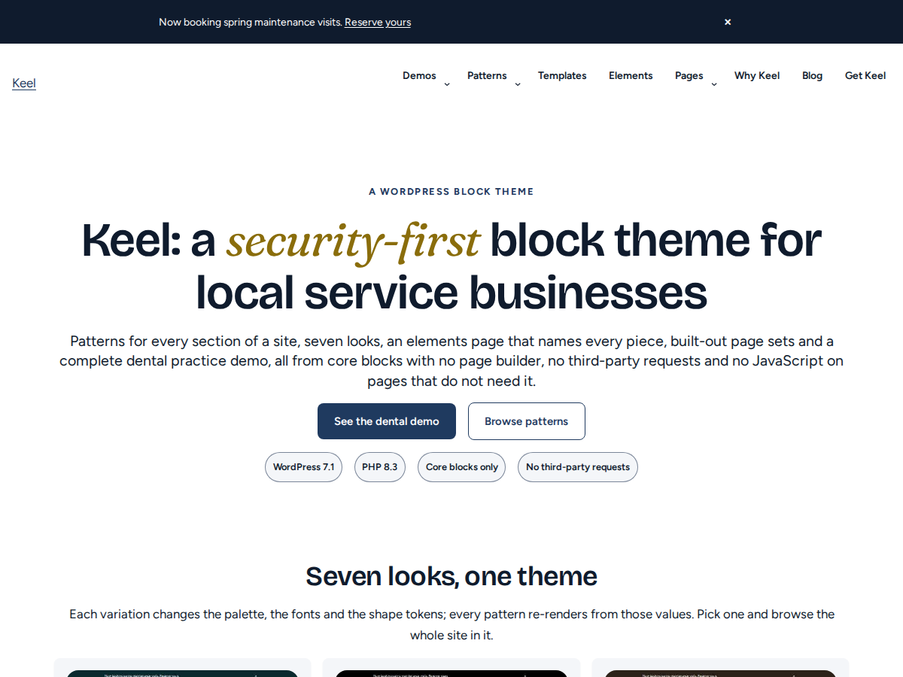 | 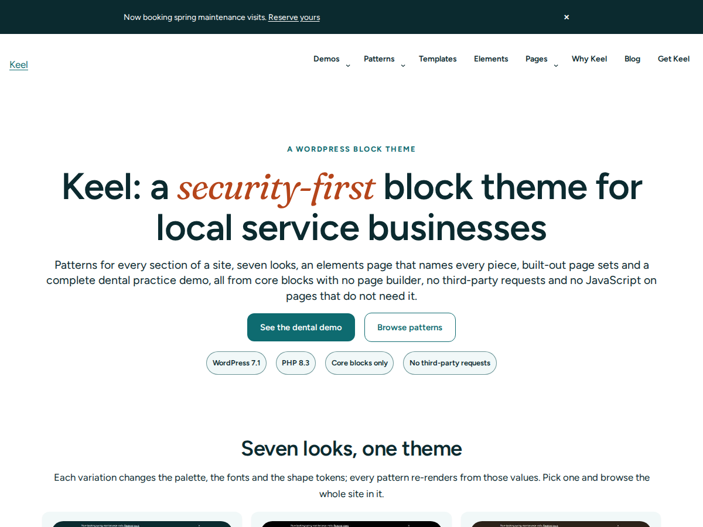 | 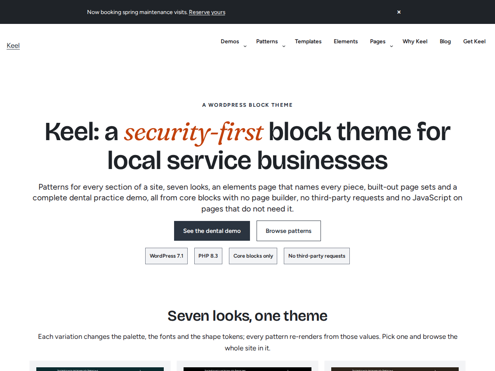 |

| Coral | Palm | Night |
| --- | --- | --- |
| 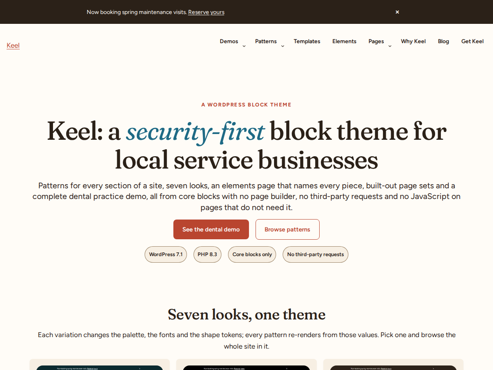 | 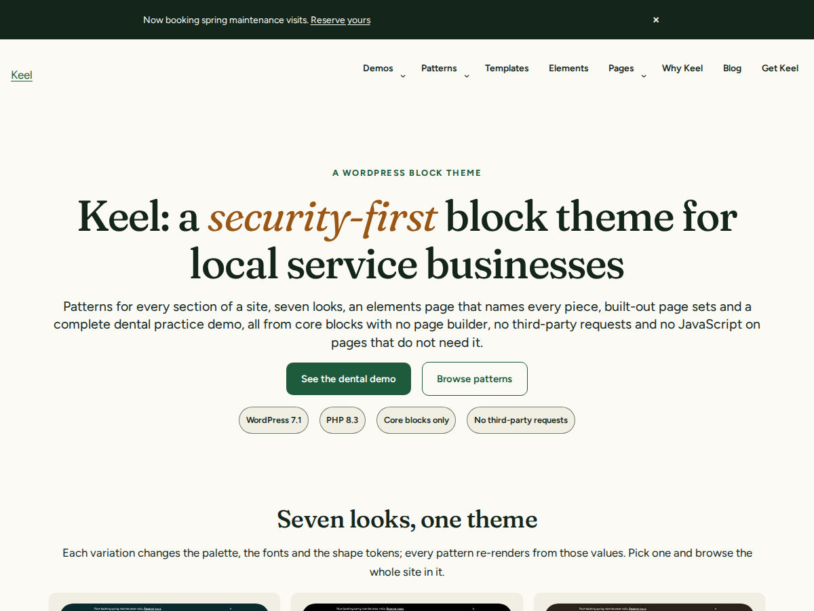 | 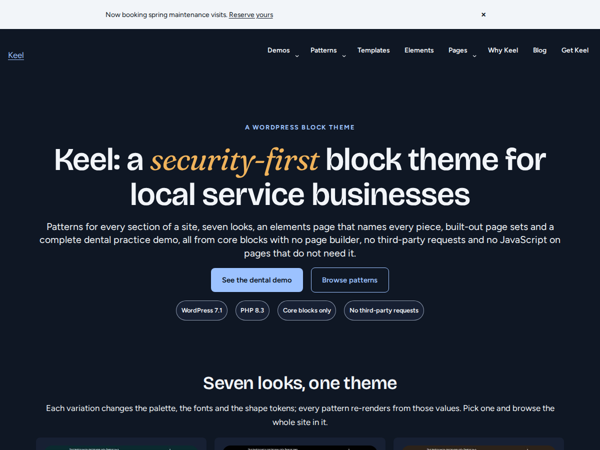 |

| Contrast | | |
| --- | --- | --- |
| 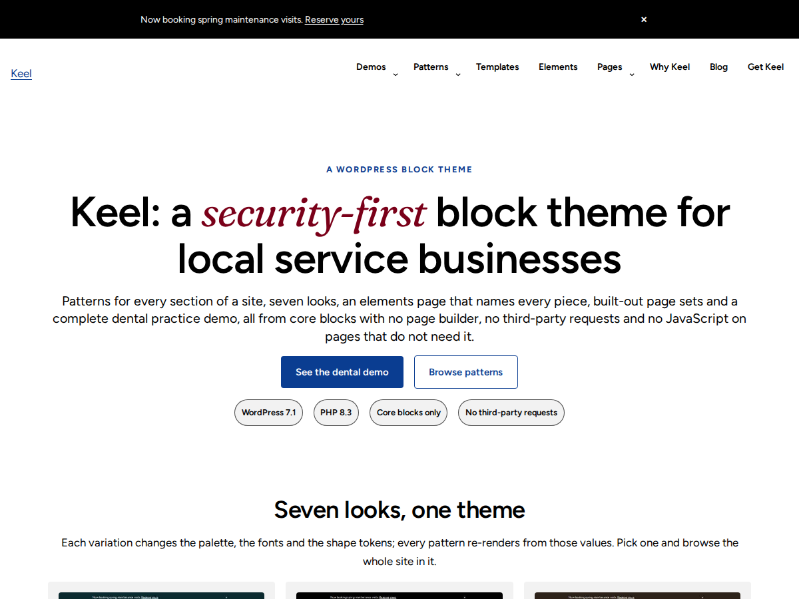 | | |

### Pages

| Elements page | Journal | Events |
| --- | --- | --- |
| 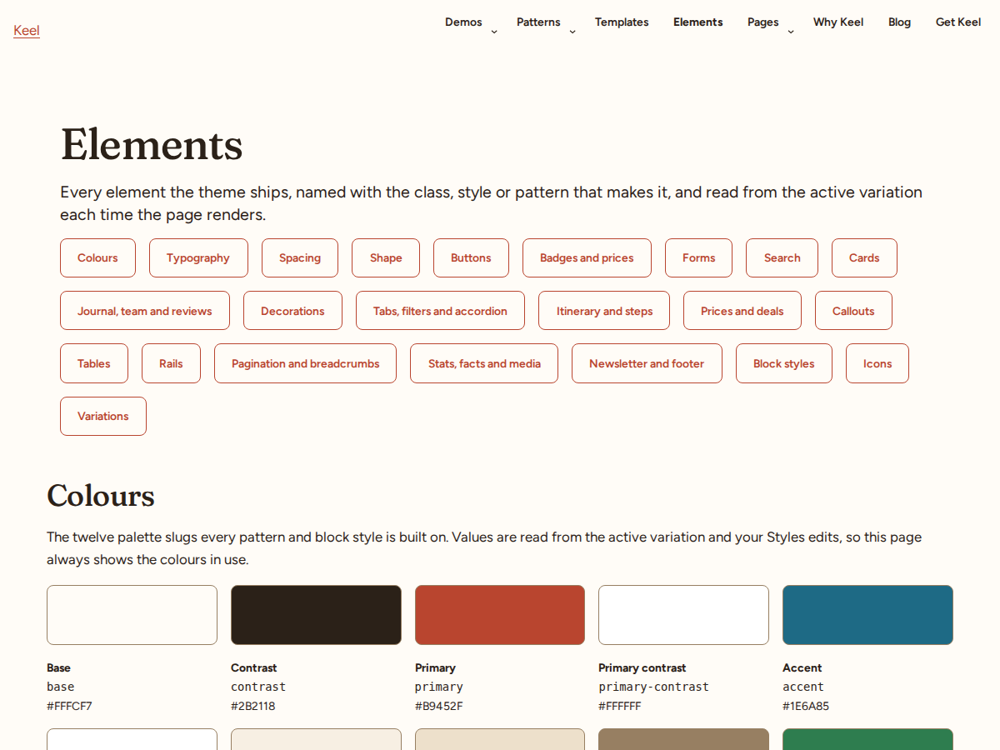 | 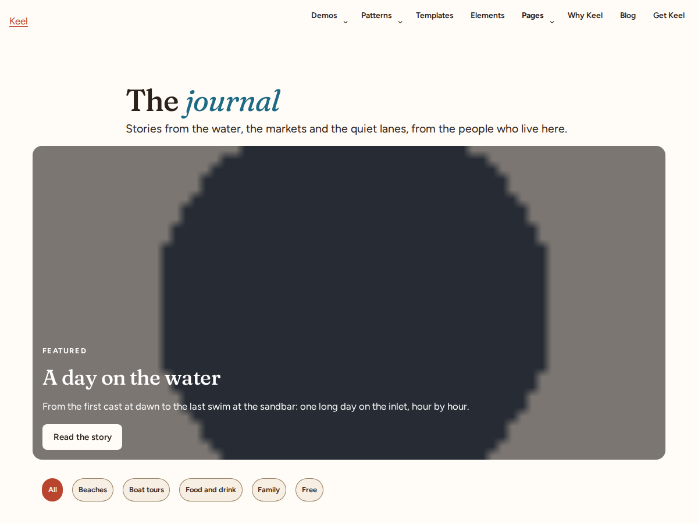 | 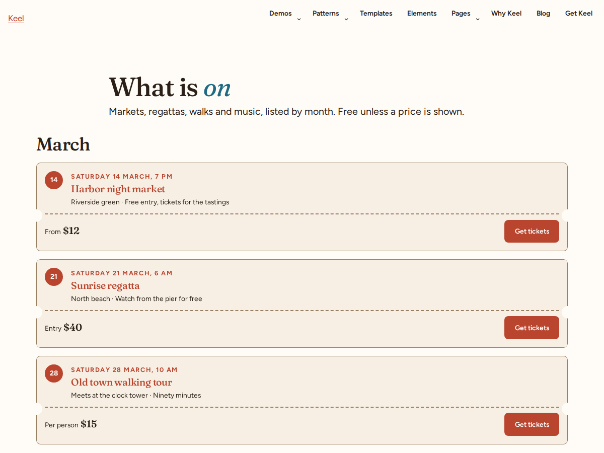 |

| Place page | Listing detail | Dental demo (Coral) |
| --- | --- | --- |
| 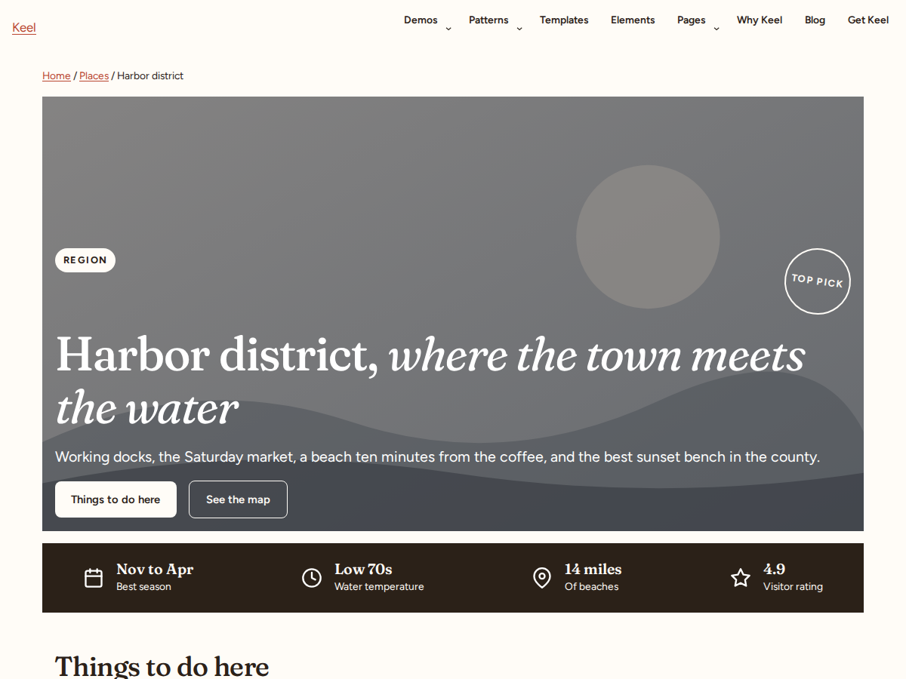 | 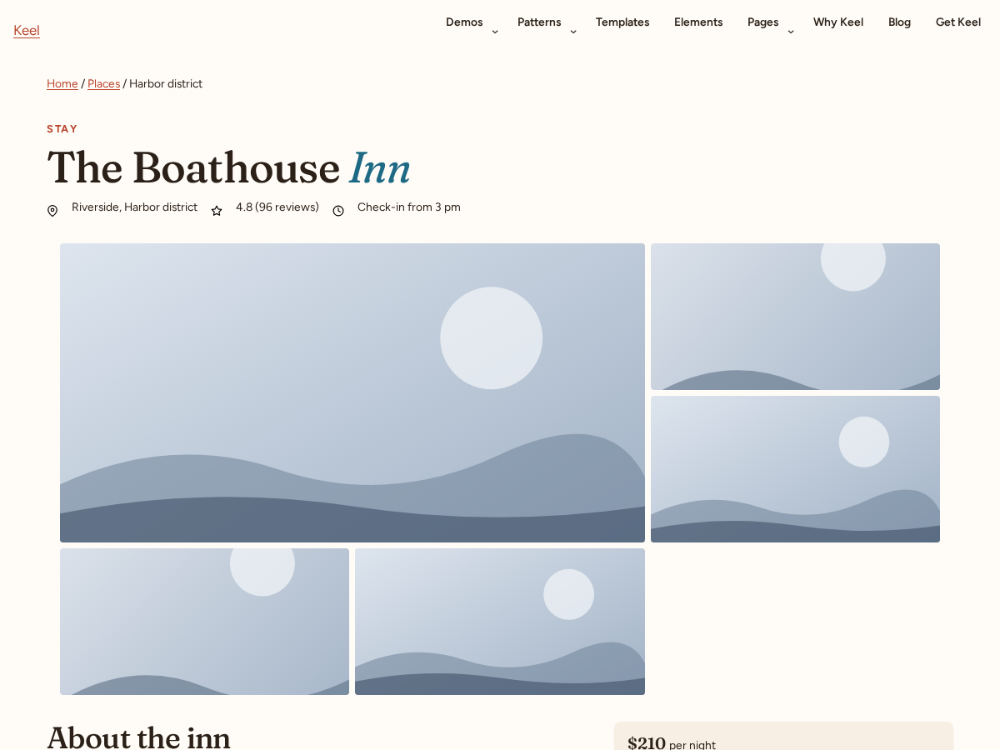 |  |

| Dental demo (Clinic) | | |
| --- | --- | --- |
| 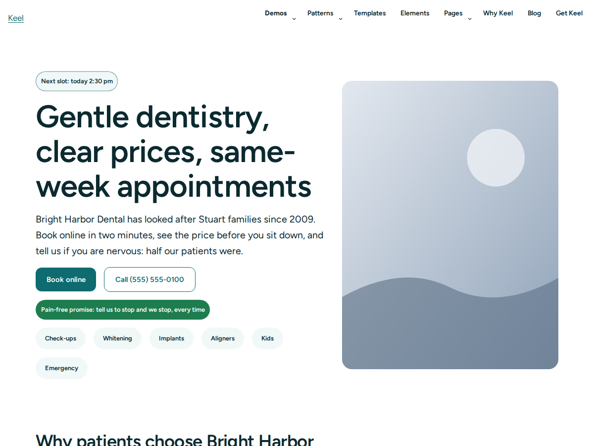 | | |

Regenerate the whole set with `node bin/screenshot.js` against a running, seeded `wp-env`.

## Requirements

| | Minimum |
| --- | --- |
| WordPress | 7.1 |
| PHP | 8.3 |
| Browser | Any current evergreen browser. Static pages work without JavaScript. |

Building from source also needs Node 24 or later, Composer 2 and Docker (for `wp-env`).

## Installation

### From a release

1. Download `keel-<version>.zip` from the [latest release](https://github.com/df2k2/keel/releases/latest).
2. In the WordPress admin go to **Appearance → Themes → Add New Theme → Upload Theme**, choose the
   zip and click **Install Now**.
3. Click **Activate**.

Or with WP-CLI:

```bash
wp theme install keel-0.3.1.zip --activate
```

Do not install the repository checkout directly: the compiled CSS and JavaScript under `build/`
are not committed, so a bare clone renders unstyled. Build it first (below) or use a release zip.

### Verify the download

Every release ships a `SHA256SUMS` file, a keyless Sigstore signature bundle for the zip, and a
CycloneDX SBOM. To check the checksum and the signature:

```bash
sha256sum --ignore-missing -c SHA256SUMS
cosign verify-blob --bundle keel-0.3.1.zip.sigstore.json \
  --certificate-identity-regexp '^https://github.com/df2k2/keel/' \
  --certificate-oidc-issuer https://token.actions.githubusercontent.com \
  keel-0.3.1.zip
```

The certificate identity proves the zip was built by this repository's release workflow on
GitHub Actions. `keel-manifest.json` inside the zip lists every shipped file with its hash.

### From source

```bash
git clone https://github.com/df2k2/keel.git
cd keel
npm install && composer install
npm run build
npm run package          # writes dist/keel-<version>.zip and dist/keel-manifest.json
```

Upload the zip from `dist/` as above, or copy the built checkout to `wp-content/themes/keel`.

### Rename the theme

Keel is a codename. To ship under your own name, run the rename script before packaging. It
rewrites the slug, text domain, constants and namespace prefixes in every tracked text file
except the licence, the changelog and `docs/`:

```bash
bin/rename.sh my-theme "My Theme" --dry-run   # preview
bin/rename.sh my-theme "My Theme"
```

## Getting started

After activation:

1. **Pick a look.** Go to **Appearance → Editor → Styles** and choose one of the seven variations.
   Everything else in Styles (colours, type, spacing) still applies on top.
2. **Choose a header and footer.** In the Site Editor open **Patterns → Template parts** and swap
   the `Header` or `Footer` part for one of the alternatives (centered, transparent, with utility
   bar, sticky; minimal or big footer). The announcement bar, mobile call-to-action bar and
   floating call to action are parts too, so add or remove them per template.
3. **Build pages from layouts.** Create a new page and the chooser offers the starter layouts.
   Each carries the page's `h1` and sensible sections; replace the copy and the placeholder images.
4. **Assign templates where it helps.** Pages can use *Landing page* (no header, minimal footer,
   for campaign pages), *Service page*, *Location page* or *Page without title*; posts can use
   *Post: cover*, *Post: with sidebar* or *Post: minimal*.
5. **Compose sections from patterns.** In the inserter, the **Patterns** tab lists every Keel
   category. Heroes and page layouts carry the page's `h1`; every other pattern starts at `h2`,
   so heading order holds whatever you stack.
6. **Add forms with any plugin.** Keel is presentation only. Drop a form plugin's block inside the
   contact shell pattern and the theme styles it.

The elements page pattern (`keel/elements`) is a useful first page on a new site: it shows every
colour, type size, button and block style of the look you picked, with the class or style name to
reach it.

## Customising

**Child theme.** Copy `examples/keel-child` to `wp-content/themes/keel-child` and activate it. Its
`theme.json` merges over the parent's, and any file dropped into `templates/`, `parts/` or
`patterns/` overrides the parent's by name. The example recolours `primary` and replaces the header
buttons through `parts/header-actions.html`. See [the child theme README](examples/keel-child/README.md).

**Header behaviour without copying a header.** Give your own header part's root block the class
`keel-header--sticky` or `keel-header--transparent` and Keel wires the scroll behaviour. From PHP,
`keel_header_part_classes` filters those classes.

**Headings in another family.** Set `styles.elements.heading.typography.fontFamily` in a child's
`theme.json` and Keel preloads that family's roman face instead of the display face.
`keel_preload_font_slugs` filters the preload list.

**Design tokens.** `theme.json` is the single source of truth: palette slugs, three font roles,
fluid type sizes, a spacing scale, radii, shadows and the focus ring. Variations under `styles/`
override palette, families and radius only. The token reference and the contrast rules are in
[CONTRIBUTING.md](CONTRIBUTING.md#design-tokens).

**New patterns.** `node bin/scaffold-pattern.js <category> <slug> "<Title>"` writes a pattern file
with the right header; `npm run docs:patterns` regenerates the pattern list.

## Development

### Quick start

```bash
npm install && composer install
npm run build
npm run env:start && npm run env:seed
```

That brings up WordPress 7.1 on PHP 8.3 at `http://localhost:8888` (admin `admin` / `password`,
the `wp-env` default) with Keel active in the Coral variation and the showcase site seeded.

### The demo site

The seed builds the same site the screenshots come from:

| Path | What is there |
| --- | --- |
| `/` | the showcase home: hero, variation strip, measured facts band, demos, templates table |
| `/patterns/` | one page per pattern category, every pattern rendered |
| `/elements/` | the elements page with every core block as its last section |
| `/journal/`, `/places/`, `/listings/`, `/events/`, `/deals/`, `/about/` | the page sets, plus team, careers, press, contact, visitor information, coming soon, maintenance, thank you, legal and one page under the Pages menu |
| `/dental/` | the dental practice demo for the fictional Bright Harbor Dental |

Append `?variation=night` (or any variation slug) to any URL to see the whole site in another
look. The switcher and the showcase-only patterns come from the demo plugin, which is mapped into
`wp-env` and never packaged; see [its README](examples/keel-demo/README.md).

### Common commands

| Command | What it does |
| --- | --- |
| `npm run build` | compile `src/css` and `src/js` into `build/` |
| `npm run lint:php` / `lint:js` / `lint:css` | PHPCS and PHPStan; ESLint; Stylelint |
| `npm run check:contrast` | contrast gate for `theme.json` and every variation |
| `npm run check:forbidden` | grep gate against `eval`, superglobals, remote calls and file writes |
| `npm run test:unit` | unit tests for the `bin` tools, CSS budget, patterns and templates |
| `npm run test:wp` | WP-CLI assertions inside `wp-env` |
| `npm run test:e2e` | Playwright: smoke, fonts, templates, interactivity, axe, keyboard, Spanish, RTL |
| `npm run test:perf` | Lighthouse CI against the demo pages with `tests/budgets.json` |
| `npm run check:theme` | Theme Check inside `wp-env` |
| `npm run i18n:pot` / `i18n:check` | regenerate or verify `languages/keel.pot` |
| `npm run package` | build the release zip and manifest into `dist/` |

The full table, the token reference and the pattern rules are in [CONTRIBUTING.md](CONTRIBUTING.md).
A pre-commit hook (installed by `npm install`) runs the PHP, JavaScript and CSS linters, the
contrast gate and the forbidden-construct gate before every commit.

### Project layout

```
assets/        fonts (Latin subsets with OFL licences), icons, placeholder images
bin/           build, package, seed, screenshot, scaffold, rename and gate scripts
build/         compiled CSS and JS (gitignored; created by npm run build)
docs/          patterns.md (generated) and review screenshots
examples/      keel-child (child theme) and keel-demo (showcase plugin, never shipped)
inc/           setup, enqueue, fonts, block styles, interactivity, speculation, patterns, elements page helpers
languages/     keel.pot and the es_ES translation
parts/         fifteen template parts
patterns/      185 pattern files, one per pattern
src/           CSS (PostCSS, per-block files) and the three Interactivity stores
styles/        seven style variations
templates/     seventeen block templates
tests/         unit (node:test), wp (WP-CLI), e2e (Playwright), budgets and contrast pairs
theme.json     the single source of truth for tokens, templates and parts
```

## Quality gates

Every pull request and every push to `main` runs these jobs, and all of them are required before a
merge. `main` keeps a linear history and refuses force pushes.

| Job | What it checks |
| --- | --- |
| `php-lint` | PHPCS (WordPress-Extra, WPThemeReview, PHPCompatibilityWP), PHPStan level 6, forbidden-construct grep |
| `js-css-lint` | ESLint with the security plugin, Stylelint with logical properties enforced |
| `unit` | contrast gate and the unit suite |
| `build-package` | the release zip builds and is uploaded as an artifact |
| `theme-check` | WordPress Theme Check inside `wp-env` |
| `e2e` | WP-CLI assertions, then Playwright: smoke, fonts, every template, interactivity, axe on every page type, keyboard journey, Spanish and right-to-left |
| `perf` | Lighthouse CI on eight demo pages, mobile profile, median of three runs |
| `i18n` | the POT file matches the source strings |
| `audit` | `npm audit` at high and `composer audit` |
| `license-check` | every production dependency is on the allow list |
| `semgrep` | PHP and JavaScript rule sets |
| `CodeQL` | JavaScript analysis, also weekly |

Lighthouse asserts a performance budget on every page: 35 KB of stylesheets, 15 KB of scripts,
160 KB of fonts, 150 KB of images, 500 KB in total and zero third-party requests, plus largest
contentful paint under 3 seconds, cumulative layout shift under 0.05, total blocking time under
150 ms and an accessibility score of 100. Every foreground and background pair the theme uses is
listed in `tests/contrast-pairs.json` and checked at 4.5:1 for text and 3:1 for UI.

## Releases

Pushing a `v*` tag runs the release workflow, which builds and packages the theme, writes
`SHA256SUMS`, signs the zip with cosign (keyless, GitHub OIDC, Sigstore bundle), verifies the
signature before publishing, generates a CycloneDX SBOM and publishes a GitHub release with all
of it attached. Tags with a suffix (`v0.0.1-m0`) publish as pre-releases. Versions follow Semantic
Versioning; the history is in [CHANGELOG.md](CHANGELOG.md).

## Security

Keel makes no network requests of its own, writes no files, stores no settings and registers no
admin pages. Scripts are ES modules registered through the Interactivity API, and directives are
attached in `render_block` filters so the editor only ever sees core blocks. The emoji detection
script and its external SVG fallback are removed. The author box and comments use no Avatar block,
so nothing fetches from Gravatar.

To report a vulnerability, use GitHub's private reporting form; see [SECURITY.md](SECURITY.md)
for response times and the supported-version policy. Please do not open a public issue.

## Translations

The text domain is `keel` and every string in templates, parts and patterns is translatable. A
Spanish (es_ES) translation ships in `languages/`; it was written by the builder and is awaiting
review by a native speaker, so corrections are welcome. Right-to-left layouts are covered by the
end-to-end tests. Regenerate the POT file with `npm run i18n:pot` and compile `.po` to `.mo` with
`npm run i18n:build`.

## Status

Keel is at version 0.3.1 and under active development ahead of a 1.0. The theme is built to pass
Theme Check and the wordpress.org theme review requirements, and Theme Check runs in CI. The
companion hardening and monitoring plugin is a separate project and is not in this repository.
Breaking changes before 1.0 are recorded in the changelog.

## Documentation

- [CHANGELOG.md](CHANGELOG.md): what changed in each release.
- [CONTRIBUTING.md](CONTRIBUTING.md): toolchain, design tokens, fonts, interactivity, pattern and
  card rules, the elements page, per-block CSS, the demo plugin and test helpers.
- [docs/patterns.md](docs/patterns.md): every pattern with its slug, keywords and template type.
- [examples/keel-child/README.md](examples/keel-child/README.md): what a child theme usually
  overrides and how.
- [examples/keel-demo/README.md](examples/keel-demo/README.md): the showcase plugin and its limits.
- [readme.txt](readme.txt): the wordpress.org theme readme.
- [SECURITY.md](SECURITY.md) and [CODE_OF_CONDUCT.md](CODE_OF_CONDUCT.md).

## License and credits

Keel is licensed under the [GNU General Public License v2 or later](LICENSE). Bundled assets:

- **Figtree**, copyright 2022 The Figtree Project Authors, designer Erik Kennedy. SIL Open Font
  License 1.1.
- **Bricolage Grotesque**, copyright 2023 The Bricolage Grotesque Project Authors, designer
  Mathieu Triay. SIL Open Font License 1.1.
- **Fraunces**, copyright 2020 The Fraunces Project Authors, Undercase Type, Phaedra Charles and
  Flavia Zimbardi. SIL Open Font License 1.1.
- **Icons** in `assets/icons` are adapted from [Feather Icons](https://github.com/feathericons/feather), MIT License.
- **Placeholder images** in `assets/images` are original work released under the GPL with the theme.

The font licences are in `assets/fonts/`. The dental demo describes a fictional practice; any
resemblance to a real business is coincidental.
